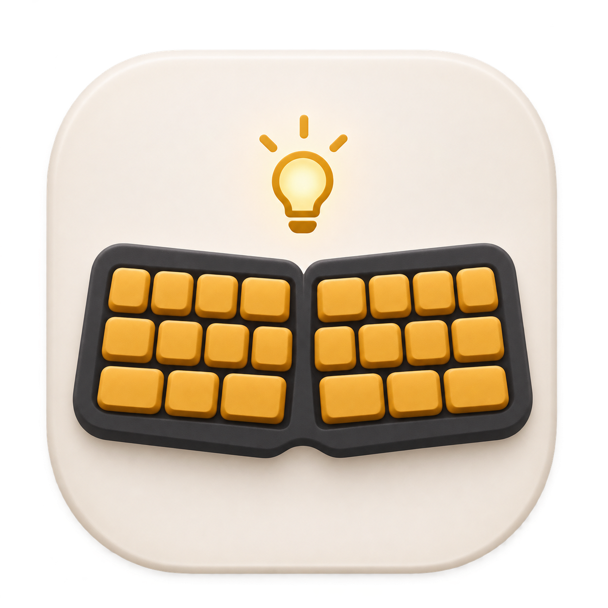
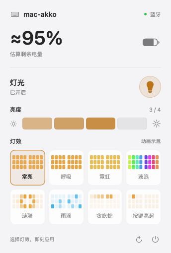

<p align="center"></p>

# mac-akko

一个安静的 macOS 菜单栏工具，查看 Akko Alice 键盘的估算电量、控制灯光。

- 菜单栏显示估算百分比，面板只展示必要信息。
- 小灯泡开关、四档亮度、八种动画灯效卡片。
- 支持浅色 / 深色模式和“减少动态效果”。
- 本地处理，不上传数据，不记录键盘输入。



*界面图中的电量为演示数据。灯效动画是示意，不代表键盘的实际颜色和精确时序。*

## 兼容范围

当前为实验性工具，针对 **Akko Armor Alice 蛇年限定版，设备 ID 2655，固件 109**：USB `3151:5025`，蓝牙 `3151:5027`。不是 Akko 官方软件，也不宣称支持全部 Akko 键盘。

**电量估算需要提供 ABT1 遥测扩展的兼容固件，以及这把键盘自己的有效满电标定。原厂固件不能直接使用这套估算，应用不会把原厂缓存的 100% 当作真实电量。** 本仓库不提供固件镜像、刷机工具或其他人的标定数据。

灯光控制使用设备的厂商协议，并校验设备与固件身份；不匹配时拒绝写入。USB 主灯开关和亮度已通过实机写入 / 双读核验；蓝牙灯光通道及各灯效仍需更多实机验证。

## 安装

需要 **Apple Silicon Mac、macOS 14 或更高版本**。

1. 在 [Releases](https://github.com/kafkalm/mac-akko/releases) 下载 ZIP，解压后打开 `mac-akko.app`，也可以放进“应用程序”。
2. 按应用提示，在“系统设置 → 隐私与安全 → 输入监控”允许 mac-akko，然后重开应用。该权限用于接收键盘专用 HID 回复，代码不记录普通按键。
3. 点击菜单栏键盘图标。蓝牙且有有效标定时显示估算电量；USB 下可控制灯光。

Release 使用临时签名，没有 Apple 开发者公证；系统可能阻止直接运行。你也可以审阅源码后自行构建。无需关闭系统安全保护。

## 电量和标定

百分比来自“当前原始采样 / 本机满电参考”与通用锂电模型，以 5 个百分点分档，`≈` 表示估算，**不代表误差为 ±5%**。电芯类型、温度和负载都会影响结果；容量精度尚未验证。

充电、休眠、断线或数据过期时停止显示新鲜电量，不伪造 100%。USB 接线与蓝牙电量可用性是两个独立状态。

兼容固件下的自动标定：先在电池供电时取得基准样本，再保持蓝牙连接充电；应用至少观察一分钟充电、十分钟连续充电结束信号，然后在拔线后取得至少五分钟稳定样本。样本质量或充电前后变化不足时不会建立参考。详细进度保存在本地 `status.json` 的 `calibrationMessage` 中。满电参考有效期为 30 天。

历史 AliceBattery 安装的满电参考与采样历史会在本机自动迁移；迁移后仍执行同样的有效性检查。不要导入别人的标定文件。

## 隐私

只使用厂商专用 HID 电量与灯光回复，没有网络请求或分析服务。数据保存在：

```text
~/Library/Application Support/mac-akko/
```

包含满电参考、有限的采样历史和诊断状态。不会随源码或 Release 发布。请勿在公开 Issue 上传未经检查的诊断、硬件设置备份或个人路径。

## 从源码构建

安装 Apple Xcode Command Line Tools，然后执行：

```sh
zsh scripts/build.sh
open build/mac-akko.app
```

构建脚本运行内置协议 / 标定测试并验证应用签名。打包发布文件：

```sh
zsh scripts/package.sh
```

`dist/` 内生成版本化 ZIP 和 SHA256。应用关闭面板时暂停动画；悬停预览不会向键盘发送设置，只有点击才会写入，写后双读确认。

## 许可和归属

MIT。电量模型的 ZMK 归属与许可见 [THIRD-PARTY-NOTICES.txt](THIRD-PARTY-NOTICES.txt)。图标由 AI 生成，设计说明见 [assets/icon-prompt.md](assets/icon-prompt.md)。Akko 名称归其权利人所有，本项目无官方关联。
